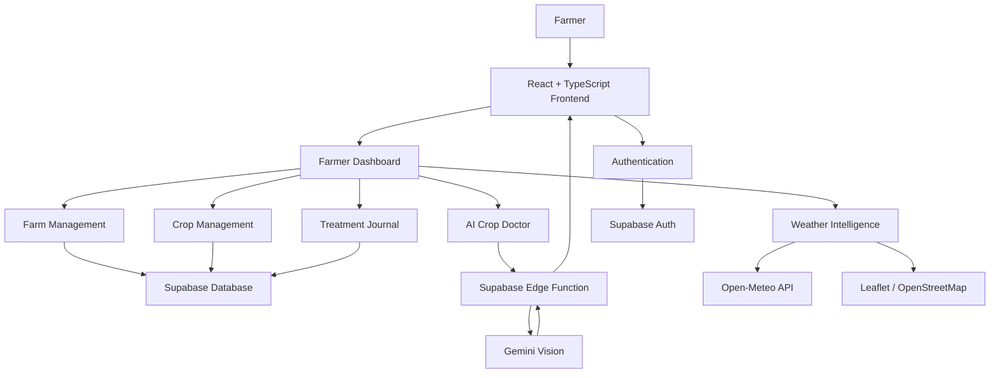

# 🌱 KrishiRakshak AI

### Smart Farming. Early Warnings. Better Harvests.

**An AI-powered agricultural assistance platform designed to help farmers monitor crops, understand plant health, manage farms and make informed farming decisions.**

<p align="center">
  
  
  
  
</p>

<p align="center">
  <b>English • తెలుగు • हिन्दी</b>
</p>

---

## 🌾 Overview

KrishiRakshak AI is a smart farming web application that brings essential agricultural management tools together in one platform.

Farmers can register their farms, manage crops, record agricultural activities, view weather information and use AI-powered crop image analysis to understand possible plant diseases and receive management recommendations.

The platform combines modern web technologies, AI-assisted analysis and multilingual support to make agricultural information more accessible.

## 🎯 The Problem

Farmers regularly face challenges such as:

- Identifying possible crop diseases at an early stage.
- Finding understandable information about crop symptoms.
- Managing multiple farms and crops.
- Keeping records of agricultural activities and treatments.
- Accessing weather information for farming decisions.
- Understanding digital agricultural tools in their preferred language.

KrishiRakshak AI aims to bring these capabilities together in a farmer-friendly application.

## ✨ Key Features

### 1. 🤖 AI Crop Doctor

- Upload crop or leaf images for AI-assisted analysis.
- Identify the likely crop and possible disease.
- View symptoms, severity and model-generated confidence estimates.
- Receive organic and biological treatment suggestions.
- Get cautious chemical-management guidance and safety recommendations.
- View preventive measures and follow-up suggestions.

*AI-generated diagnoses are advisory and should not replace laboratory testing or qualified agricultural expert advice.*

### 2. 🌦️ Weather Intelligence

- Weather information using the Open-Meteo service.
- Location-based weather forecasting.
- Weather information to support farm planning.
- Interactive map-based location selection.

### 3. 🚜 Farm Management

- Register and manage farm plots.
- Save farm location and geographical coordinates.
- Manage farm information in one dashboard.
- Associate crops with their respective farms.

### 4. 🌱 Crop Management

- Register crops under individual farms.
- Track crop information and growth stages.
- Organize active crop records.
- Connect crop records with farm activities.

### 5. 📋 Farm Activity Management

- Record agricultural operations.
- Maintain activity history.
- Organize farming records for better tracking.

### 6. 💊 Smart Crop Solution Advisor

- Receive AI-assisted crop management recommendations.
- View immediate actions and preventive measures.
- Explore organic and biological control options.
- Review treatment safety guidance.
- Get suggested recovery follow-ups.

### 7. 📖 Treatment Journal

- Record treatments applied to crops.
- Maintain treatment dates and observations.
- Track recovery status.
- Follow up on crop conditions.
- Associate treatments with the correct farm, crop and diagnosis.

### 8. 🌍 Multilingual Experience

The application supports three languages:

| Language | Code |
|---|---|
| English | EN |
| Telugu | TE |
| Hindi | HI |

- Language selection across the application.
- Centralized translation dictionary.
- AI-assisted translation of saved diagnosis information.
- Supabase-backed translation caching.

---

## 🛠️ Technology Stack

| Category | Technologies |
|---|---|
| Frontend | React 19, TypeScript |
| Build Tool | Vite |
| Styling | Tailwind CSS |
| UI & Animation | Framer Motion, Lucide React |
| Charts | Recharts |
| Backend / Database | Supabase |
| Authentication | Supabase Auth |
| Serverless Functions | Supabase Edge Functions, Deno |
| AI Integration | Gemini Vision |
| Weather | Open-Meteo API |
| Maps | Leaflet, React Leaflet, OpenStreetMap |
| Development | VS Code / Antigravity, Git, GitHub |

## 🏗️ System Architecture



## 📂 Project Structure

```text
KrishiRakshak-AI/
│
├── public/
│
├── src/
│   ├── components/
│   ├── context/
│   ├── locales/
│   ├── pages/
│   │   └── cropDoctor/
│   ├── services/
│   ├── types/
│   ├── utils/
│   ├── App.tsx
│   └── main.tsx
│
├── supabase/
│   ├── functions/
│   │   └── crop-diagnosis/
│   │       └── index.ts
│   └── migrations/
│
├── .env.example
├── package.json
├── vite.config.ts
└── README.md
```

## ⚙️ Installation and Setup

### Prerequisites

Install the following:

- Node.js (LTS recommended)
- npm
- Git
- Supabase account
- Deno (for Edge Function development)

### 1. Clone the repository

```bash
git clone https://github.com/srijachoodisetti/KrishiRakshak-AI.git
```

### 2. Open the project

```bash
cd KrishiRakshak-AI
```

### 3. Install dependencies

```bash
npm install
```

### 4. Configure environment variables

Create a `.env.local` file in the project root.

```env
VITE_SUPABASE_URL=YOUR_SUPABASE_PROJECT_URL
VITE_SUPABASE_PUBLISHABLE_KEY=YOUR_SUPABASE_PUBLISHABLE_KEY
```

Use your own Supabase project credentials. Never commit `.env.local` or expose private service-role keys in frontend code.

### 5. Configure Supabase

1. Create a Supabase project.
2. Configure the project URL and publishable key.
3. Apply the SQL migrations in the `supabase/migrations/` directory in the correct order.
4. Verify database tables and Row Level Security policies.
5. Configure authentication and email verification.

### 6. Configure Gemini for the Edge Function

Store the Gemini API key as a Supabase Edge Function secret, not in the frontend environment file.

```bash
npx supabase secrets set GEMINI_API_KEY=YOUR_GEMINI_API_KEY
```

### 7. Deploy the Edge Function

Authenticate and link your Supabase project:

```bash
npx supabase login
npx supabase link --project-ref YOUR_PROJECT_REF
```

Deploy:

```bash
npx supabase functions deploy crop-diagnosis
```

### 8. Start the development server

```bash
npm run dev
```

Open:

```text
http://localhost:5173/
```

### 9. Build for production

```bash
npm run lint
npm run build
```

---

## 🔐 Security

KrishiRakshak AI uses Supabase authentication and database Row Level Security to protect farmer-specific information.

Security considerations include:

- Authenticated access to farmer features.
- Database access policies for farmer-owned records.
- Server-side storage of the Gemini API secret.
- No private API secrets in frontend source code.
- Secure handling of uploaded crop images.
- Protected Edge Function operations.

## 🌱 Future Enhancements

Potential areas for further development:

- More regional Indian language support.
- Improved crop disease identification and evaluation.
- Integration with agricultural expert networks.
- More personalized weather-based crop alerts.
- Advanced farm analytics and crop performance reports.
- Mobile-first and offline-friendly farming experiences.

## 📸 Application Screenshots

Screenshots will be added here as the application UI is finalized.

Suggested screenshots:

1. Landing Page
2. Farmer Dashboard
3. Farm Management
4. Crop Management
5. AI Crop Doctor
6. Diagnosis Results
7. Treatment Journal
8. Weather Intelligence
9. Telugu and Hindi interfaces

## 🤝 Contributing

Contributions, suggestions and feedback are welcome.

1. Fork this repository.
2. Create a feature branch.
3. Commit your changes.
4. Open a pull request describing your improvements.

## ⚠️ Disclaimer

KrishiRakshak AI provides AI-assisted agricultural information for educational and decision-support purposes. AI-generated crop diagnoses and treatment recommendations may be inaccurate. Always verify important crop-health decisions with qualified agricultural experts or local Krishi Vigyan Kendras (KVKs).

## 👩‍💻 Project

**KrishiRakshak AI**

Repository: [github.com/srijachoodisetti/KrishiRakshak-AI](https://github.com/srijachoodisetti/KrishiRakshak-AI)

**Smart Farming. Early Warnings. Better Harvests.** 🌱

---

<p align="center">
  Made with 🌱 for smarter and more sustainable agriculture.
</p>